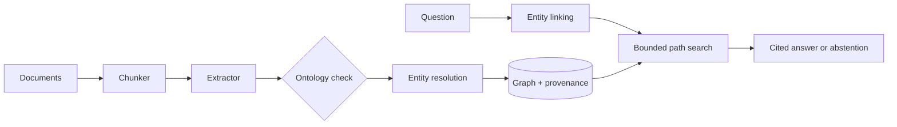

# Graphlore

**Build a knowledge graph from text, then answer relationship questions with cited, bounded
multi-hop paths, and abstain when the graph has no support.**

Graphlore keeps every extracted fact tied to the sentence it came from. Questions are answered by
walking typed edges, not by guessing: each answer lists the path and the source text for every step,
and a question with no supporting path gets "no supported answer" instead of a fluent guess.

## Status

Implementation and test suite are included. **No benchmark or evaluation results are published.**
The bundled corpus, gazetteer, ontology and question set are **hand-written and fictional**, meant to
demonstrate the pipeline. The Neo4j adapter and the spaCy and model-based extractors are written but
not exercised by the test suite. See [Limitations](#limitations).

## Features

| Area | What it does |
| --- | --- |
| Ontology | YAML types and typed relations with trigger phrases, question cues, symmetry and inverses; checked for consistency on load |
| Chunking | Sentence-aware, overlapping chunks that keep character offsets |
| Extraction | Rule-based (gazetteer + triggers) by default; optional spaCy NER and model-based extractors |
| Resolution | Name normalisation and fuzzy merging with documented thresholds; near-misses reported, not merged |
| Storage | `GraphStore` protocol with in-memory NetworkX and optional Neo4j implementations |
| Provenance | An edge cannot be stored without a chunk it cites; loading re-validates everything |
| Querying | Entity linking, relation-cued expansion, paths between two entities, hop and search bounds |
| Answers | Deterministic text with numbered citations; optional model rephrasing with fallback |
| Evaluation | Harness for exact match and gold-edge recall on a question file |
| Export | JSON (lossless) and GraphML |

## Architecture



Details: [docs/ARCHITECTURE.md](docs/ARCHITECTURE.md), the formal model in
[docs/KNOWLEDGE_MODEL.md](docs/KNOWLEDGE_MODEL.md), and decisions in [docs/adr](docs/adr).

## Quick start

```bash
pip install -e ".[dev]"

# Build a graph from the fictional sample corpus
graphlore build --input examples/corpus --output graph.json

# Ask questions
graphlore query "Where does Mira Okafor work?"
graphlore query "Who founded Northwind Labs?"
graphlore query "How is Mira Okafor connected to Portugal?"

# Export for a visualisation tool
graphlore export --format graphml --output graph.graphml

# Compute metrics on your own question file (see eval/qa.jsonl for the format)
graphlore eval --qa eval/qa.jsonl
```

An answer looks like this (structure only; the content depends on your graph):

```text
Answer from graph evidence:
1. Mira Okafor -[WORKS_AT]-> Helio Systems [1] -[HEADQUARTERED_IN]-> Lisbon [2] ...
Sources:
[1] <doc>:<n>: "<the supporting sentence>"
```

### How questions are interpreted

- **Two or more known entities** in the question: return paths from the first to each other entity,
  up to `--max-hops` (default 3).
- **One known entity:** expand from it. If the question contains cue words listed in the ontology
  (for example "work" or "headquartered"), only those relations are followed; otherwise all are.
- **No known entity, or no path within the bound:** abstain.

### Using your own data

1. Edit `ontology/default.yaml`: types, relations, trigger phrases and cue words.
2. List your entities and surface forms in `ontology/gazetteer.yaml`.
3. Run `graphlore build --input <folder> --ontology <yaml> --gazetteer <yaml>`.

For other extractors, `--extractor spacy` needs the `spacy` extra and a downloaded model, and
`--extractor llm --provider ollama --model <name>` uses a local model. `--provider openai` sends
text to a remote service and is refused unless you pass `--allow-remote`.

### Optional Neo4j

`graphlore.neo4j_store.Neo4jStore` implements the same interface with the same provenance and
ontology rules. Install the `neo4j` extra and construct it with your connection details from
`.env.example`. It is not wired into the CLI and has not been tested against a live database.

## Project layout

```text
src/graphlore/
  models.py       Document, Chunk, Triple, Entity, Edge
  ontology.py     types, relations, triggers, cues
  loader.py       txt, md, pdf
  chunker.py      sentence-aware chunking
  extract.py      gazetteer and the three extractors
  resolver.py     normalisation and fuzzy merging
  graph.py        GraphStore, NetworkXStore, provenance rules
  neo4j_store.py  optional Neo4j store
  build.py        build pipeline
  qa.py           linking, path search, cited answers
  evaluate.py     metrics harness
  export.py       JSON and GraphML
  cli.py          command line
ontology/        sample ontology and gazetteer (hand-written)
examples/        fictional sample corpus
eval/            hand-written sample questions
tests/           pytest suite
docs/            architecture, formal model, decision records
```

## Limitations

- **Low-recall default extractor.** Only active-voice statements inside one sentence, between
  adjacent known entities, with a listed trigger phrase. Passive voice, coreference ("she", "the
  company") and unlisted entities are missed.
- **Exact entity linking.** Questions must use a name stored in the graph; paraphrases and typos are
  not matched, and short aliases appear only if the resolver recorded them.
- **Sentence splitting is heuristic.** Abbreviations such as "Dr. Okafor" can be split wrongly.
- **Graph answers only.** Open-ended questions and anything outside the extracted facts get no answer.
- **Facts are not versioned or reconciled.** Conflicting sources both produce edges, and there is no
  notion of time.
- **Confidence values are not calibrated.** Rule-based edges all carry confidence 1.0.
- **Resolution is quadratic** in distinct names per type.
- **Not evaluated.** No accuracy, recall or latency figures exist. The sample question set is
  hand-written and tiny, and results on it should not be generalised.
- **Untested optional parts.** Neo4j, spaCy and live-model paths have not been exercised, and the
  test suite and CI configuration have not yet been run in a clean environment.

## Roadmap

- Passive-voice patterns and simple coreference in the rule extractor.
- Embedding-assisted entity linking (hybrid with the graph).
- Edge confidence from extractor agreement, with calibration on a labelled sample.
- Temporal validity on edges and conflict reporting.
- A published evaluation on an open dataset with the method and results written up.
- Neo4j in the CLI, with an integration test in CI.

## Development

```bash
make install
make check     # ruff, mypy, pytest
```

## License

MIT, see [LICENSE](LICENSE).
