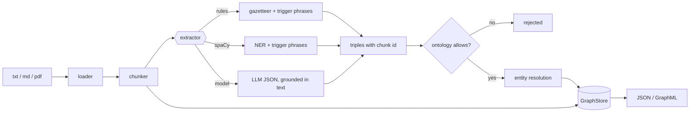
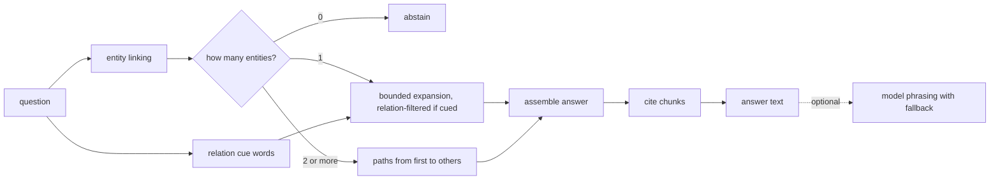

# Architecture

## Build pipeline

## Query pipeline

## Modules

| Module | Responsibility |
| --- | --- |
| `ontology` | Typed relations, trigger phrases (for text) and cue words (for questions); validates its own consistency |
| `loader`, `chunker` | Read documents; split into overlapping sentence groups with character offsets |
| `extract` | `Gazetteer`, `RuleExtractor`, `SpacyExtractor`, `LLMExtractor` behind one `Extractor` protocol |
| `resolver` | Normalise names, merge close variants, list near-misses for review |
| `graph` | `GraphStore` protocol and `NetworkXStore`; enforces typing and provenance on every write |
| `neo4j_store` | Optional store with the same rules; relation names are allow-listed before use in Cypher |
| `build` | Orchestrates chunking, extraction, validation, resolution and storage |
| `qa` | Entity linking, bounded path search, cited answers, optional phrasing |
| `evaluate` | Exact match and gold-edge recall on a question file |
| `export` | Lossless JSON and flattened GraphML |

## Data flow guarantees

- **Provenance is mandatory.** `add_edge` raises `ProvenanceError` without an existing chunk id.
- **Ontology is enforced twice.** Extractor output is filtered in `build`, and the store rejects
  violations again, so a custom extractor cannot bypass it.
- **Loading re-validates.** `NetworkXStore.from_dict` re-adds everything through the same checks,
  so a hand-edited JSON file cannot smuggle in an invalid edge.
- **Answers are assembled, not generated.** The deterministic text is always available; the model
  can only rephrase it, and the original evidence is appended.

## Extension points

- New extractor: implement `extract(chunk) -> list[Triple]`.
- New store: implement `GraphStore`; keep the two write rules.
- New ontology: edit the YAML; consistency checks run on load.
- Better linking: replace `link_entities`, which currently uses exact normalised matching.

## Performance notes

Entity resolution is quadratic in distinct names per type. Path search is bounded by `max_hops`,
`max_paths` and `max_expansions`. The in-memory store is meant for corpora that fit in memory;
the Neo4j adapter exists for larger graphs but has not been exercised by the test suite.
